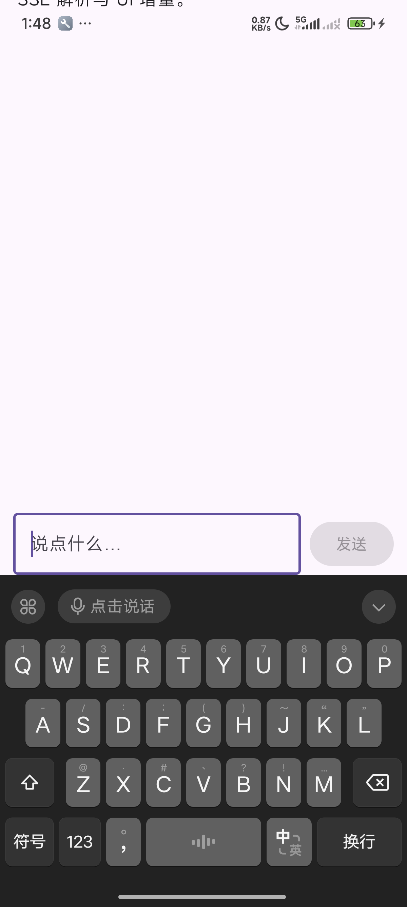
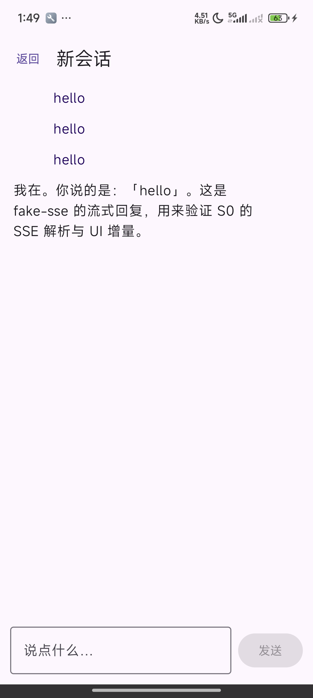

# 真机验证报告 · Android（2026-11-26 01:50）

> 设备：`24129PN74C`（adb serial `7e7c5a68`）、Android 15 / API 35。
> 安装包：`app-android-debug.apk`（debug，未开 R8，约 9.5MB）。
> 目的：完成 A8 的"一次性真机窗口"——装一次、跑完关键路径、导出证据、回滚。

## 1. 结果总览

| 项 | 结果 | 证据 |
|---|---|---|
| 安装 | 成功（`adb install -r`） | Success |
| 冷启动 | **413–651 ms**（多次） | `am start -W` TotalTime |
| 内存 | PSS **147 MB** / RSS **274 MB**（debug） | `dumpsys meminfo` |
| 设置页 provider 管理 | 成功：加本地模板 → 保存 → 列表显示 `local / openai-completions / models: fake-chat`（revision=1） | 截图/UI dump 文本 |
| SSE 流式对话 | **成功**：手机 → `adb reverse tcp:8787` → PC 上 fake-sse，流式回复完整显示 |  |
| 历史持久化 | **成功**：force-stop → 重启 → 打开会话，3 条 user + 1 条 assistant 全部还原 |  |
| 前台服务（FGS） | **成功**：`isForeground=true`、`foregroundId=1001`、`types=0x40000000`（specialUse）、通知渠道 `myco.presence`；停止后 service 消失 | `dumpsys activity services` |

## 2. 真机暴露并修掉的 4 个 Android-only 问题

1. **`java.nio.file.Files.readString/writeString` 在 Android 上不存在**（API 35 仍缺）。
   现象：doctor 报 `No static method writeString`，会话写入失败。
   修复：core 新增 `io/TextFiles`（`readAllBytes` / `Files.write`），替换全部读写点。
2. **明文 HTTP 默认被禁止**（Android 9+）。
   现象：`LLM_FAILED: Cleartext HTTP traffic to 127.0.0.1 not permitted`。
   修复：`network_security_config.xml` 只对 `127.0.0.1`/`localhost` 放行明文，远程仍强制 HTTPS。
3. **缺 `INTERNET` 权限**。
   现象：`socket failed: EPERM (Operation not permitted)`。
   修复：manifest 加 `android.permission.INTERNET`。
4. **会话历史回放没有 payload**：`Query.SessionEvents` 只返回 `{type,seq,at}`，UI 解析不到文本。
   现象：重启后会话为空（数据其实在）。
   修复：`eventJson` 补 `data{text,...}`；加单测断言历史查询包含消息文本。

## 3. 测量说明

- 以上是**这台机**的数字；4800mAh、性能不弱，但不能当普遍结论（A8）。
- RSS 274MB 超了 S0 设定的 120MB 目标，但这是 **debug + Compose + 未裁剪** 的包；release（R8/minify、去掉 tooling）再测一次才有意义。
- 24h 存活/耗电本轮**未测**（需要更长的窗口），留到下一次。

## 4. 怎么复现（下次窗口用）

```powershell
$adb = "$env:LOCALAPPDATA\Android\Sdk\platform-tools\adb.exe"
& $adb -s <serial> install -r app-android\build\outputs\apk\debug\app-android-debug.apk
# 本地假模型（PC）
.\tools\fake-sse\build\install\fake-sse\bin\fake-sse.bat 8787
& $adb -s <serial> reverse tcp:8787 tcp:8787
# 手机：设置 → 加本地模板 → 保存；新建会话 → 发消息
```

回滚：`adb -s <serial> uninstall dev.myco.android`（本轮保留安装，方便你继续看；不需要时卸载即可）。

## 5. 下一轮真机要补的

1. release APK 的包体/冷启动/RSS（R8 后）。
2. 24h FGS 存活 + 耗电（一次长时间窗口）。
3. 用**DeepSeek 官方 provider**在手机上跑一轮（HTTPS，不需要 adb reverse；key 走设置页输入，不进仓库）。
4. 中文输入法下的发送/IME 行为（本轮用 adb input 英文，未覆盖中文 IME）。
