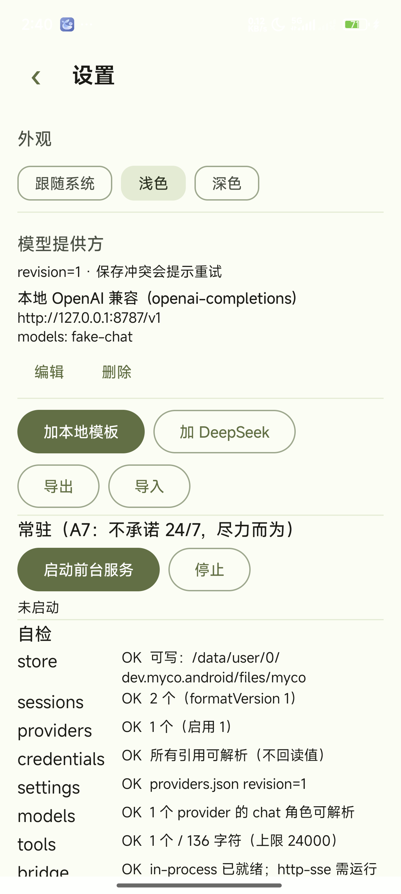
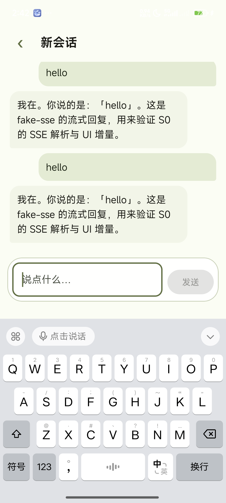
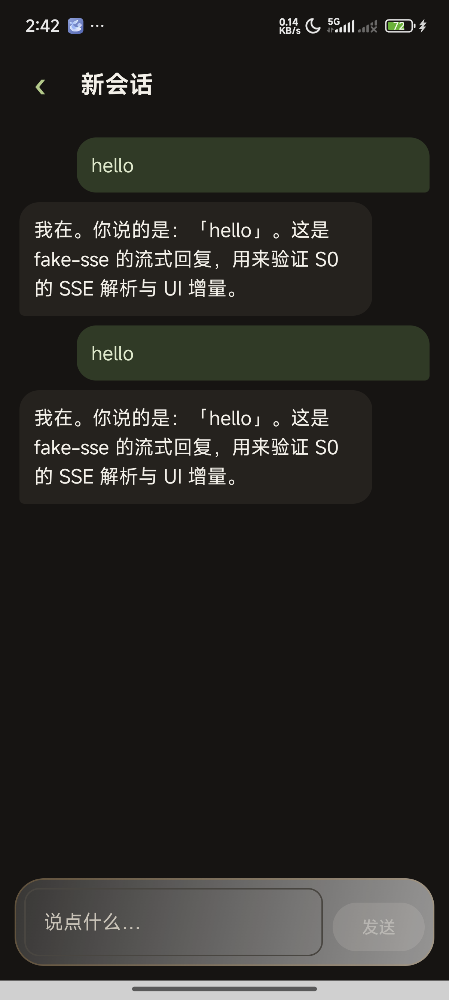

# M1 视觉地基报告（2026-11-26 02:55）

> 目标：把色卡变成语义令牌；基础组件与状态稳定；设置页有外观切换；不追装饰级视觉（M6 再做）。
> 真机验证：Android 15 / API 35（24129PN74C），浅色 + 深色两套截图。

## 1. 已落地

- **`ui/Theme.kt`**：`MycoTheme`（SYSTEM/LIGHT/DARK）+ `ColorScheme` + 扩展色 `LocalMycoColors`
  （glow/glass/bubble…）+ `MycoSpacing`（4dp 网格）+ `MycoRadius`（12/16/24）+ 排版（系统字体）。
- **`ui/Components.kt`**：`MycoTopBar`、`GlassSurface`（半透明 tint + 1dp 边框；深色用发光色做边缘）、
  `SectionHeader`、`SettingsRow`、`EmptyState`、`InlineError`、`ChatBubble`（user/assistant/error/system + streaming/stopped）、
  `ChatComposer`（发送/停止）、`Divider`。
- **`ui/ThemePrefs.kt`**：外观偏好持久化（SharedPreferences；默认跟随系统）。
- **设置页**：外观三档（跟随系统/浅色/深色）+ 分组（外观/模型提供方/常驻/自检）。
- **聊天页**：`imePadding`（键盘不再挡输入区）、**自动贴底**（用户上翻时不拽回）、
  气泡长按复制（Toast 提示）、流式/停止态可见。
- **对比度修正**：浅色模式下 `B0C591` 直接当文字/描边太浅（实测发灰）——主色文字/描边改为同色相深绿
  `#5F7040`，浅绿保留在容器/选中态；深色不受影响。色卡整体气质保留。

## 2. 截图

| 浅色设置 | 浅色聊天 | 深色聊天 |
|---|---|---|
|  |  |  |

## 3. 来自 ux-recon 的修正（已采纳/排期）

- **M1 现在做**：键盘遮挡、贴底滚动、消息长按菜单（先做"复制"，重试/引用下轮）、空态 5 类、停止态、错误条。
- **M4 修正**：chat 单焦点不要"抽屉留空"——空入口比没有入口更反用户。改为：
  chat 顶栏一个「历史」一级入口（搜索/五档分组/归档恢复/删除），work 保留多会话；
  将来 work 能跑任务后再合壳上底部 Tab（Claude 的 Chat/Code 形态）。
- **M6**：真 backdrop blur（Compose 无官方 API，需 Haze 且可关）；发光用 radialGradient + drawBehind，不用 shadow。
- **不做**：装饰动效、分支切换、多选、轮次面板（M6 之后）。

## 4. 当前测试/构建

`:core:test` 39 + `:bridge-http:test` 6 = 45 绿；`:app-android:assembleDebug` ok；真机截图见上。

## 5. 下一轮（M2 工具循环）

- 两方言 tool calls（OpenAI tools/tool_calls、Anthropic tool_use/tool_result）；
- Bridge 执行 `ToolRegistry` 并回灌；`tool/call`/`tool/result` 事件落盘；schema 预算测试；
- 用 `time_now` 在真机上跑通"模型调用工具→结果回灌→继续回答"。
