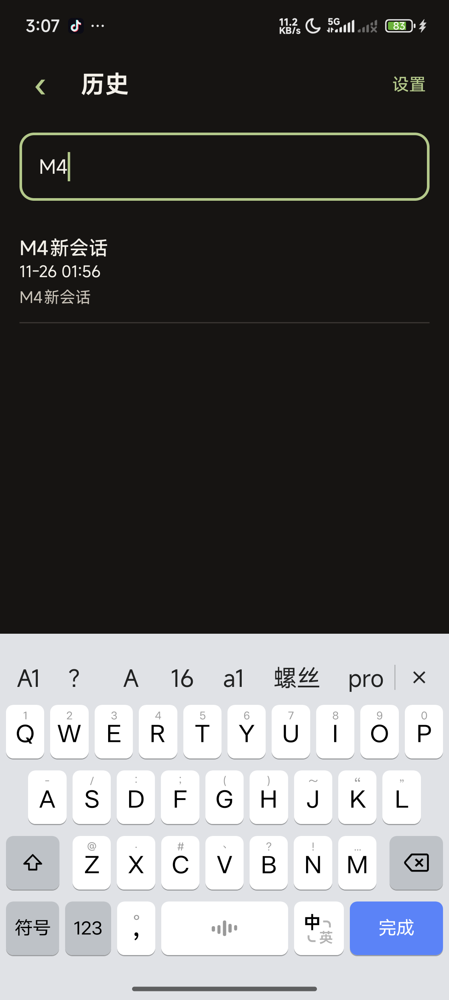
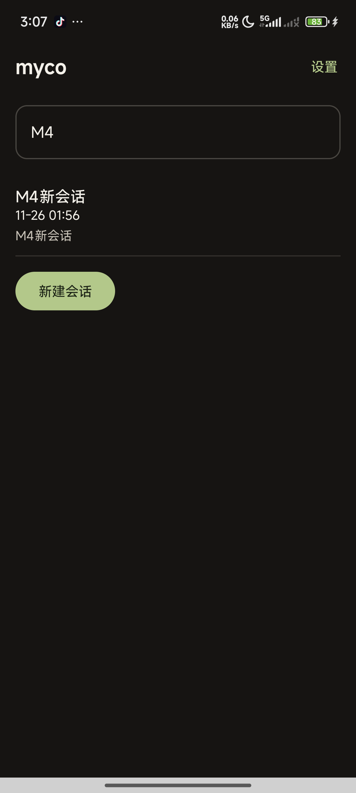

# M4 会话管理与形态分叉报告（2026-11-26 03:20）

## 1. 结论

会话 **改名 / 软删 / 恢复 / 搜索** 全部落地（core + Bridge + http-sse + Android），
**chat 单焦点 / work 多会话** 通过一个持久化开关分叉；真机 Android 15 上逐项点过。

## 2. 数据模型：为什么没有改 formatVersion

事件日志保持 append-only + formatVersion=1 不变；可变展示状态放同目录 sidecar：

`<session>/meta.v1.json` = `{schemaVersion, title?, deletedAt?, pinned?}`

- 改名只改 sidecar，历史事件一个字节不动；
- 删除 = 软删（写 `deletedAt`），列表默认隐藏，`restore` 可恢复；
- 这样不需要为新事件类型升 formatVersion，也不会让旧日志读不出来。
- 校验规则不变：首事件仍必须是 `session/start(f=1)`。

## 3. 能力

| 层 | 内容 |
|---|---|
| SessionStore | `rename` / `delete` / `restore` / `search`（标题 + user/assistant 文本，大小写不敏感，软删不出现） |
| Bridge | `SessionRename` / `SessionDelete` / `SessionRestore`；`Query.SessionSearch(query,limit)` |
| http-sse | `session.rename` / `session.delete` / `session.restore` / `/session.search` |
| 桌面 CLI | 尚未加独立命令（GUI/Bridge 已可用；下一轮补 CLI rename/delete/search 方便脚本） |
| Android | 「历史」页：搜索框、长按菜单（改名/删除）、重命名输入、删除二次确认；应用形态开关 |

## 4. chat / work 分叉（按 ux-recon 建议）

- **chat 模式（默认）**：启动直接打开最近一次对话；顶栏入口「历史」= 搜索/长按管理；
  **没有多会话首页**，也不做"空抽屉"。
- **work 模式**：以会话列表为首页（新建会话/设置/长按管理），保留多会话。
- 形态存 SharedPreferences（`myco.app/app_mode`），设置页「应用形态」chips 切换，切换时清空搜索词。
- 将来 work 能跑任务后，可合壳上底部 Tab（Claude Chat/Code 形态）。

## 5. 真机验证（Android 15 / API 35）

| 操作 | 结果 |
|---|---|
| chat 模式启动 | 直接进入最近会话，顶栏有「历史」 |
| 历史页 | 搜索框 + 会话列表 + 返回 |
| 搜索 "M4" | 只剩改名后的会话（标题/片段命中） |
| 长按会话 | 弹出「对会话做什么？」→ 改名/删除 |
| 改名 | 输入并保存 → 列表标题立即更新（sidecar 生效） |
| work 模式 | 设置里切换后，首页变为多会话列表（新建/设置） |

截图：  

**诚实记录**：adb 脚本第一次点「历史」未生效（UI 首帧未就绪的竞态），第二次点击正常；不是代码路径问题，
但说明脚本验证需要在点击前等可交互。此现象已记录。

## 6. 测试

`:core:test` **54** + `:bridge-http:test` **6** = **60 绿**。
新增：sidecar 改名不改日志、软删/恢复、搜索标题+正文+软删过滤、Bridge rename/delete/restore/search 往返。

## 7. 已知缺口

1. 没有"回收站"UI（restore 只有桥命令）；删除后要恢复需要后续加入口。
2. 搜索逐会话读全量事件，无索引/分页；会话很多时会慢（M4 范围内先接受）。
3. 改名不写事件，因此同步/导出只带 sidecar（同步协议还没做，M6 后再说）。
4. 桌面 CLI 的 rename/delete/search 命令未加。
