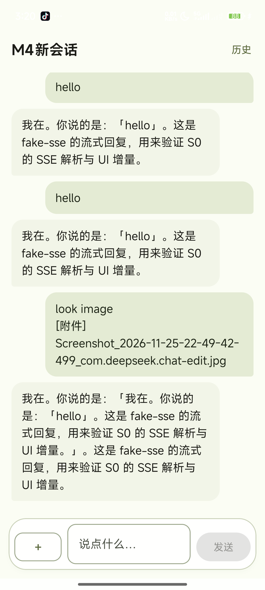
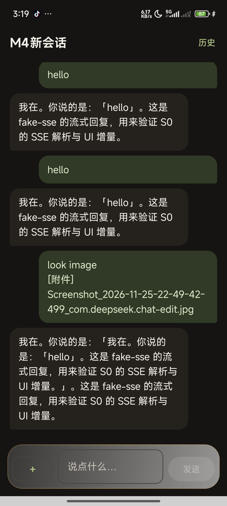
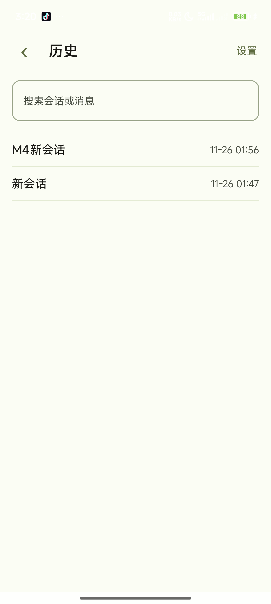
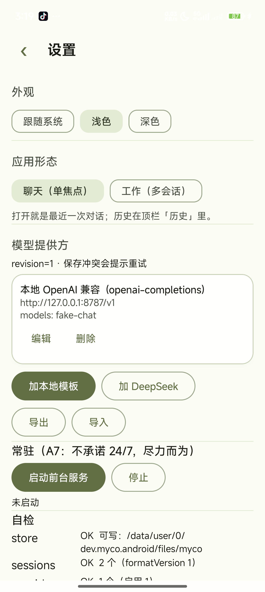

# M6 视觉细化报告（2026-11-26 03:45）

> 目标：基于 M1 的稳定组件做"装饰级"细化；不改交互逻辑。真机 Android 15 / API 35，浅色 + 深色。

## 1. 本轮改动

| 区域 | 改动 |
|---|---|
| 主题/令牌 | 浅色补充 `primaryContainer` 层级；深色玻璃/发光仍只用 `E09A42` 做边缘；统一 12/16/24 圆角 |
| 气泡 | 更柔和的非对称圆角（18/18/4/18），浅色下 1dp 极轻阴影，深色无阴影；`animateContentSize` 让流式变高不跳 |
| 输入区 | 聚焦时边框/阴影加强（`interactionSource`），「＋」附件按钮固定在最左，发送/停止不变 |
| 历史页 | 会话行改为"标题 + 右侧时间 + 两行片段 + 分隔线"；搜索框与输入区圆角/描边统一 |
| 空态 | 增加同色系两圈装饰（Canvas，不抢内容），文案不变 |
| 设置页 | provider 改成玻璃卡片（浅色阴影、深色发光边），区块间距统一 |
| 聊天可用性 | 用户上翻后出现「↓ 回到最新」按钮（贴底逻辑保持 40px 阈值语义） |
| 列表项 | 统一 `SessionListItem` / `SearchField` 组件，删除页内重复样式 |

## 2. 真机截图

| 浅色聊天 | 深色聊天 | 浅色历史 | 浅色设置 |
|---|---|---|---|
|  |  |  |  |

## 3. 与 DeepSeek chat 原版的对照（差距清单）

**已达到**：单焦点会话、顶栏历史入口、气泡左右分组、停止生成、附件「＋」、明暗主题、设置分组、
搜索、长按会话管理、错误条/空态/贴底滚动。

**仍有差距（后续做，不阻塞 MVP）**：
1. 没有 Markdown 渲染（粗体/列表/代码块/表格）——DeepSeek chat 有；当前是纯文本。
2. 没有语音输入按钮；没有重新生成/停止后的继续生成。
3. 消息长按只有"复制"，缺引用/重试/选择文字；没有消息级操作条。
4. 没有模型切换快捷入口（设置里改 provider 才行）。
5. 没有首 token 三段反馈（转圈/进度）、没有 token 用量展示。
6. 图片消息没有缩略图（只显示文件名）。
7. 没有 DeepSeek 式"思考过程"折叠（我们默认关思考）。

> 说明：未做与 DeepSeek App 的并排截图（会暴露用户自己的聊天内容）；以上按 ux-recon 的心流基线逐项对照。

## 4. 已知问题

- 「↓ 回到最新」的触发在测试会话里没出现（消息太少，一屏放得下，`atBottom` 恒为真）；逻辑已实现，长会话待复验。
- 深色发光仍为边框线性渐变，没有真实 backdrop blur（Compose 限制，M6 约定不做 Haze）。
- provider 卡片在浅色下阴影较明显，若嫌重可再降 `elevation`（当前 3dp/焦点 6dp）。

## 5. 测试/构建

`:core:test` 64 + `:bridge-http:test` 6 = **70 绿**；`:app-android:assembleDebug`、`:app-desktop:installDist` 通过。
本轮是 UI 层改动，未新增单测；真机截图作为验收证据。
