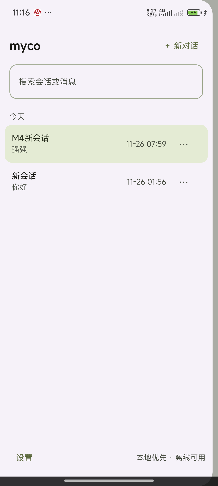
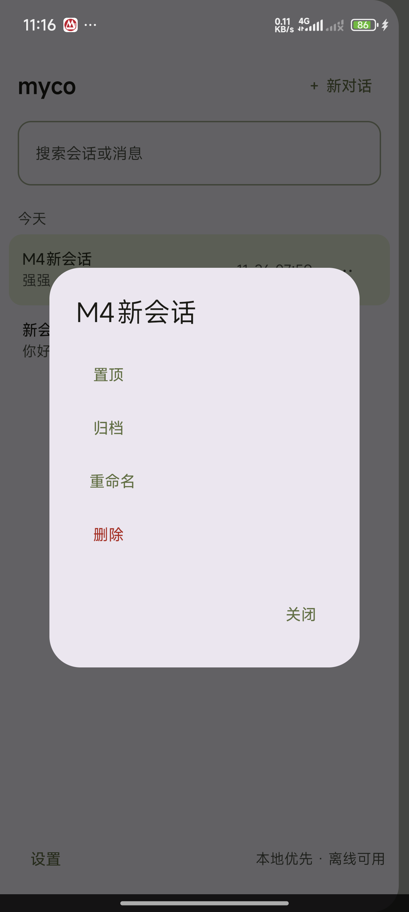
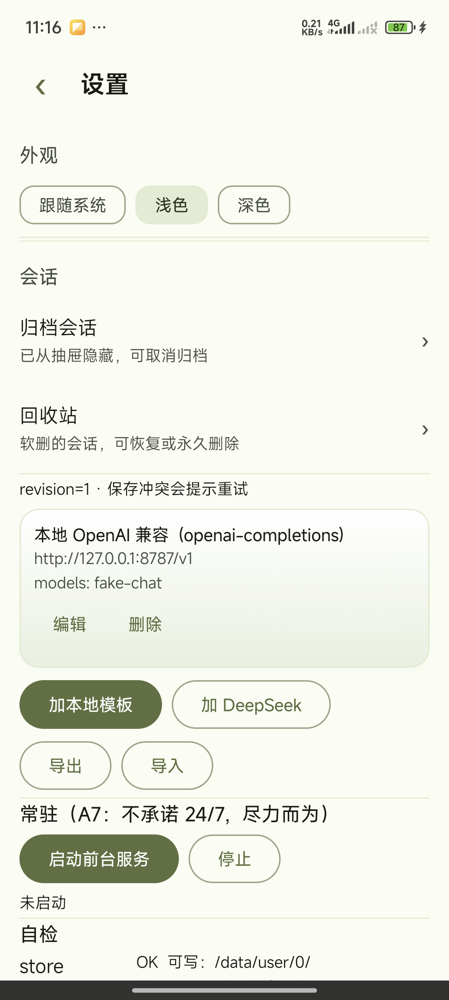
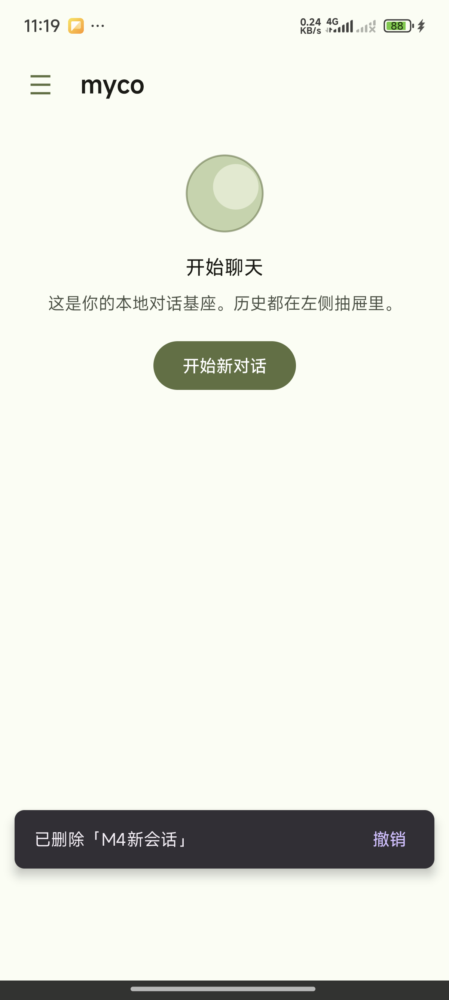

# B2 + U1 报告：会话管理、抽屉与回收站（2026-11-26）

## 1. B2 后端

- `SessionSidecar` 新增 `archivedAt`；新增 `SessionSummary`（lastMessageAt/preview/messageCount/pinned/archivedAt/deletedAt）。
- `SessionStore.summaries(includeArchived, includeDeleted, app)`：默认排除归档+回收站，置顶优先、按最近活动排序。
- 新方法：`setPinned`、`archive`、`deletePermanently`（删日志目录+该会话附件目录，不可恢复）。
- 搜索：返回 `seq`/`role`（为 U2"跳到那条消息"准备），排除归档/回收站；`includeArchived` 可选。
- Bridge：`SessionPin` / `SessionArchive` / `SessionDeletePermanent`；`Query.SessionList` 增
  `includeArchived/includeDeleted`；`SessionSearch.includeArchived`；JSON 增 preview/lastMessageAt/messageCount/pinned/archived/deleted。
- http-sse：对应命令/查询全部映射。
- 测试：core **74** + bridge **7** = **81 绿**（pin/archive/permanent、summaries、search seq/role、bridge 往返）。

## 2. U1 Android

- 抽屉：填满高度、列表 `weight(1f)`、底部设置固定；行=标题+时间+两行预览+⋯；置顶组/今天/昨天/本周/更早。
- ⋯ 可点击打开菜单：置顶/取消置顶、归档、重命名、删除、关闭。
- 删除：二次确认 → 软删 → 抽屉先关闭 → Snackbar「已删除…撤销」→ 撤销=restore。
- 归档：Snackbar「已归档…撤销」→ 撤销=unarchive。
- 设置新增「会话」组：归档会话 / 回收站两个页面；回收站支持恢复/永久删除（二次确认），归档页支持取消归档。
- **视觉方向调整**（按用户意见）：卡片默认改为**完全不透明渐变表面 + 柔和彩色阴影**（深色仍是同色系不透明渐变 + 发光边缘），不再使用普通半透明；真毛玻璃留作后续显式可选（Haze，单独升级 spike）。

## 3. 真机验证（Android 15 / 254129PN74C）

| 操作 | 结果 |
|---|---|
| 聊天页返回 | 打开抽屉而不是退出 App ✅ |
| 抽屉布局 | 全高、底部设置固定、预览/时间/⋯ 正常 ✅ |
| ⋯ 菜单 | 置顶/归档/重命名/删除/关闭 ✅ |
| 置顶 | 抽屉出现「置顶」组 ✅ |
| 设置 | 会话组（归档/回收站）✅ |
| 回收站空态 | 正常 ✅ |
| 删除 | 确认→从抽屉消失→Snackbar「已删除…撤销」✅ |
| 撤销点击 | **未验证**：Snackbar 在脚本点击前已超时消失（代码路径简单，下轮补） |
| 归档页/归档撤销 | 未做真机点验 |
| 平板常驻侧栏 | 未实现（U1 后续 WindowSizeClass） |

截图：   

## 4. 已知问题/下一步

1. 搜索命中 `seq` 已返回，但点击结果"跳到该条消息"未实现（需要消息列表按 seq 定位 + 高亮）。
2. 归档/回收站页面未真机覆盖；撤销点击未赶上脚本时序。
3. 平板常驻侧栏（≥600dp）未实现。
4. 设置页仍非"分组卡片 + 搜索设置"完整形态（U4）。
5. push 仍被 GitHub 502（FlClash 代理对 GitHub 也返回 502，google 200），代码在本地。
