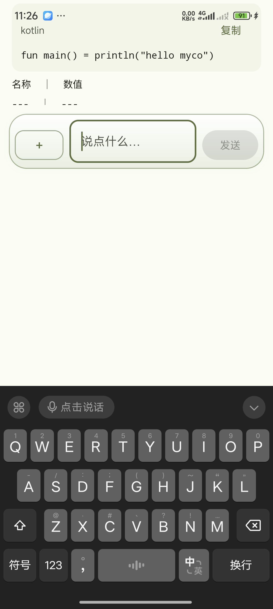
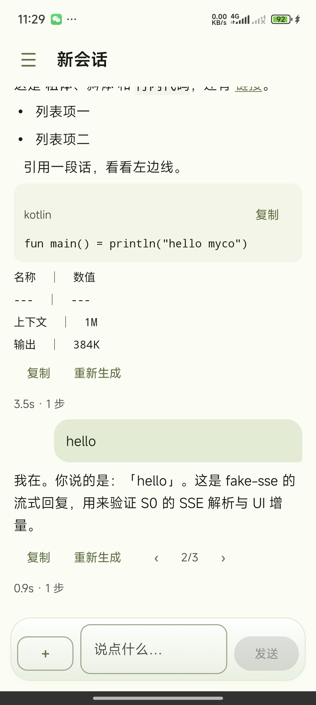

# U2 报告：Markdown / 消息操作条 / 同节点版本 / footer（2026-11-26）

## 1. 已实现

### 助手消息渲染（基座形态）
- 助手消息**全宽、无气泡**；气泡只给用户（chat 变体未来可加回）。
- `MarkdownText` 基础集：标题（#/##/###）、粗体/斜体/行内代码、链接（下划线，未接点击）、无序/有序列表（悬挂缩进）、引用（左边线）、围栏代码块（语言标签+复制+横向滚动）、表格按等宽行渲染。
- 代码块可复制；段落/代码可选中（SelectionContainer）。
- 流式：流式内容也走 Markdown 渲染，末尾光标 ▍。

### 消息操作条
- 每条助手消息下常显：**复制 / 重新生成**；多版本时出现 `‹ 2/3 ›` 切换。
- 重新生成调用 B3 的 `ChatRegenerate`（同 nodeId、version+1），完成后自动刷新为最新版本。
- 版本切换只切本地显示（不动存储）；‹/› 边界禁用。

### footer 与过程
- 每条助手消息 footer：`耗时 · 步数 · 成本 · 状态`（来自 turn/end；stopped/error/truncated 显示原因）。
- 有工具调用的轮次：在助手消息前显示可折叠「过程 · N 步」，展开显示工具名/成功失败/结果摘要；工具步骤的中间 assistant 文本不再单独渲染。
- reasoning_content 已落盘（B1），UI 折叠块预留（下一步接）。

### 真机验证（Android 15）
- Markdown：标题/粗斜体/行内代码/列表/引用/代码块+复制/表格 全部正常（fake-sse 返回 Markdown 样本）。
- 操作条：复制/重新生成/footer 正常。
- 重新生成：点一次后出现 `2/3`，切 ‹ 后显示 `1/3` 且正文切换 ✅。
- **发现并修复一个真崩溃**：版本链渲染时同一个 messageId 作为 LazyColumn key 重复 → `IllegalArgumentException: Key ... already used`；改为只渲染选中版本 + index+messageId key。

截图： 

## 2. 测试/构建

`:core:test` 77 + `:bridge-http:test` 7 = **84 绿**；`:app-android:assembleDebug`、desktop 通过。

## 3. 未完成/已知问题

1. **editResend 未做**（B3 遗留）：编辑用户消息重跑需要 user 消息版本/supersede 语义。
2. 过程折叠未真机验证（fake 无工具调用）；reasoning 只落盘未展示（折叠块只显示工具步骤）。
3. Markdown 链接不可点击（只下划线）；表格是等宽行近似；半截围栏/嵌套列表/公式未处理。
4. 版本切换状态在 reload 后重置为最新；"设为当前版本"持久化（activeVersion）未做。
5. 流式期间操作条/旧版本与新流式项可能短暂并存（无严重问题）。
6. 长按消息只有操作条复制；长按完整菜单（引用/选择文字/删除版本）未做。
