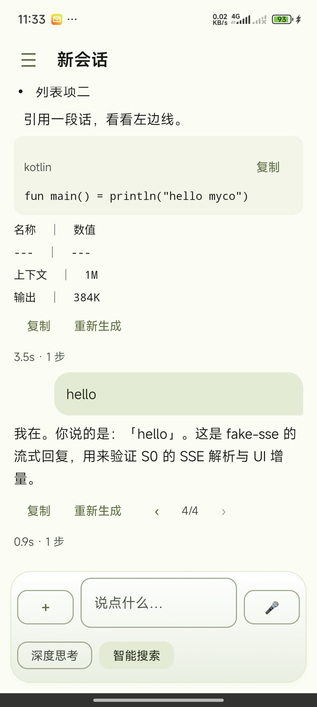
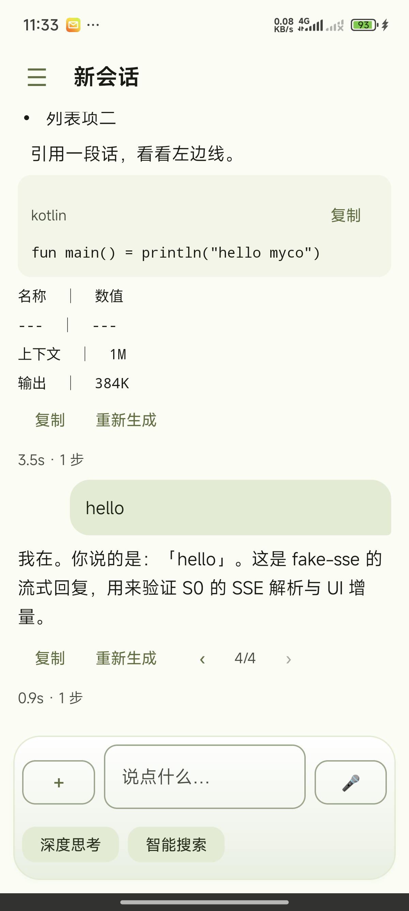

# U3 报告：输入状态机 / 模式 chips / ASR 可选入口（2026-11-26）

## 1. 已实现

### 输入区状态机
- **空输入、未生成**：显示 🎤（有 `onVoice` 时）；无发送键。
- **有文字**：显示发送；多行最高 4 行。
- **生成中**：显示停止（点击 `ChatStop`，保留部分文本）。
- **有附件/无文字**：显示发送（enabled=true 时）。
- 附件 chip 行、清空、附件 Sheet 保持原行为。

### 模式 chips（按轮开关）
- 输入区新增「深度思考」「智能搜索」两个 FilterChip（与 DeepSeek 一致）。
- 后端 `ChatSend` 新增 `thinking: Boolean?` / `webSearch: Boolean?`：
  - `thinking` 透传 `ChatRequest.thinking`；OpenAI 方言对 DeepSeek 显式发 `thinking.type=disabled/enabled`（默认关，避免默认开思考烧钱）；
  - `webSearch=false` 时从本轮 tools 中过滤 `web_search`/`read_url`（其他工具保留）；null=默认。
- 测试：thinking=true/false 透传、webSearch=false 过滤、OpenAI body 含 thinking enabled。

### DeepSeek ASR 可选入口
- 新命令 `Command.TranscribeAudio(name,mime,base64)`：用首个 provider 的 DeepSeek 能力客户端做 ASR，返回 `text/durationMs`。
- Android：🎤 打开音频文件选择器（audio/*），读取 → base64 → `TranscribeAudio` → 识别文本追加到输入框；失败明确报错（"当前 provider 不支持 DeepSeek ASR"/"没有识别到文字"）。
- 说明：当前是"选音频文件转写"，不是麦克风实时录音；DeepSeek ASR 要求 16-bit PCM WAV/Ogg Opus，实时录音需要 AudioRecord+WAV 封装，留作后续。
- http-sse：`audio.transcribe` 已映射。

## 2. 真机验证（Android 15）

- 输入区：＋ / 输入框 / 🎤，下方「深度思考」「智能搜索」chips；智能搜索默认开（高亮）✅
- 点 🎤 打开系统文件选择器（音频过滤，设备上没有音频文件 → "无任何文件"）✅
- 消息操作条/footer/版本切换在此前 U2 已验；本轮截图见下。

截图： 

## 3. 测试/构建

`:core:test` **79** + `:bridge-http:test` **7** = **86 绿**；Android/桌面构建通过。

## 4. 未完成/已知

1. **麦克风录音转写未做**（需 AudioRecord/WAV 封装；ASR 只接文件选择）。
2. ASR 依赖 provider 是 DeepSeek 且有 key；本地 fake provider 会明确报不可用。
3. 模式 chips 状态不持久化（每次进会话默认 思考关/搜索开）；应存会话级或全局设置（U4）。
4. 排队/插话（生成中发消息）仍只显示停止；`ChatStop` 未带 turnId（UI 侧可以传但暂未传）。
5. 附件面板未加"最近照片"；上传状态仅限本地保存失败提示。
