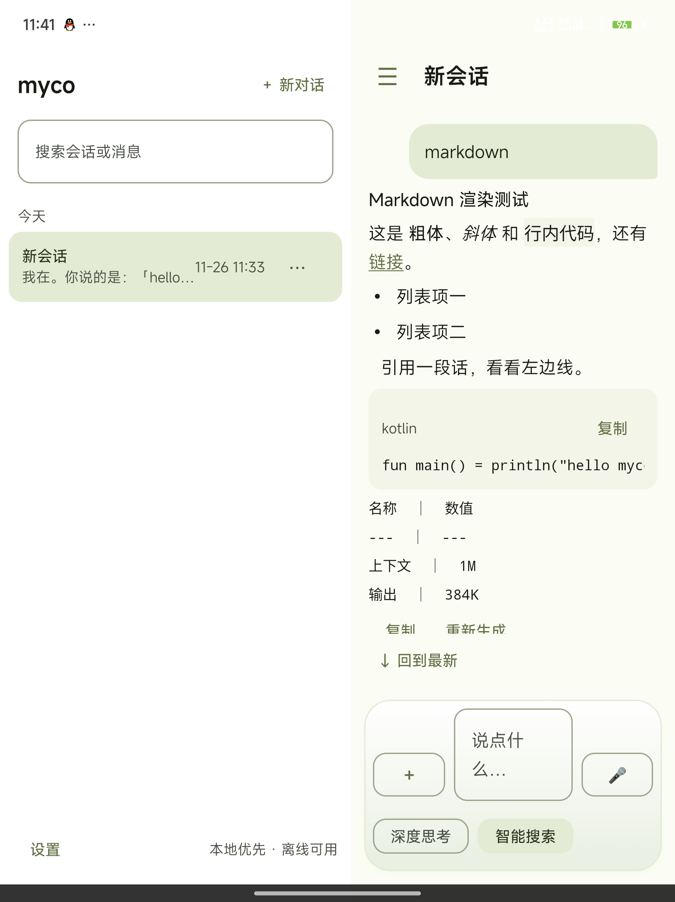

# U4 报告（部分）：平板常驻侧栏 / reasoning 折叠 / 表格修正（2026-11-26）

## 1. 平板/横屏常驻侧栏

- Shell 改为 `BoxWithConstraints`：
  - 手机（<600dp）：`ModalNavigationDrawer` 覆盖式（原行为不变，返回规则不变）；
  - 平板/横屏（≥600dp）：`PermanentDrawerSheet`（宽 320dp）+ 右侧内容，**同一个 `MycoDrawerContent` 组件**，不是两套 UI。
- 宽屏下隐藏汉堡菜单（抽屉常驻），设置/回收站返回仍生效。
- 真机强制宽屏（`wm size 2000x2670`，约 762dp）验证：左侧抽屉常驻 + 右侧 Markdown 聊天/输入区同时可见 ✅；已 `wm size reset` 还原。

截图：

## 2. 过程折叠展示 reasoning

- `ChatContentState` 增加按 turn 聚合的 `reasoning`（来自 assistant/message.reasoning）。
- 展开「过程」时先显示「思考：…」（截断 500 字），再列工具步骤；流式 reasoning 已由 B1 落盘。

## 3. Markdown 表格修正

- 表格分隔行（`|---|:---|`）不再作为内容渲染；表头/数据行仍按等宽行显示。

## 4. 真机状态

- 平板布局 ✅；手机布局沿用之前验证。
- **editResend UI 仍未真机点验**：脚本在"点输入框→输入→发送"步骤反复受键盘/坐标影响；服务端语义有单测。
- 撤销点击时序、归档页仍未点验。

## 5. 测试/构建

`:core:test` 80 + `:bridge-http:test` 7 = **87 绿**；Android/桌面构建通过。

## 6. 仍未做（收尾清单）

1. 设置页"分组卡片 + 搜索设置"未做（U4 剩余）。
2. activeVersion 持久化（版本切换 reload 后回最新）。
3. 归档/回收站/撤销真机点验；editResend 真机点验。
4. push 仍被 GitHub 502。
5. 底座总验收（对照 80 组件规格逐项打勾）未做。
