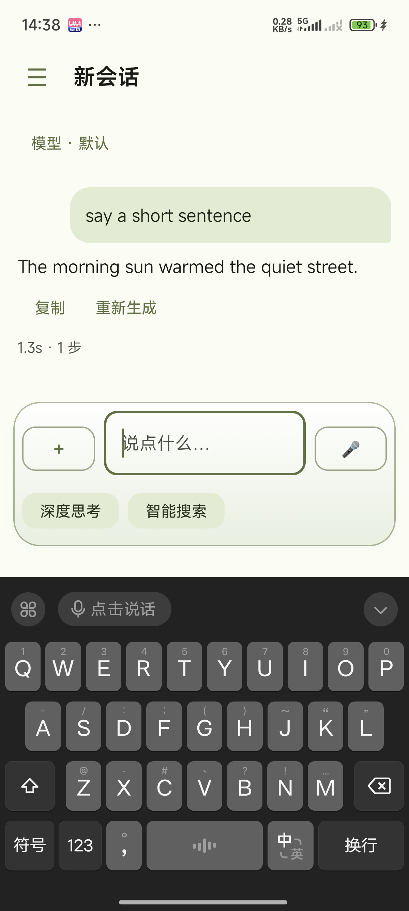
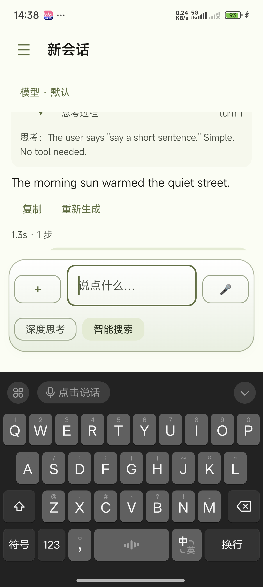
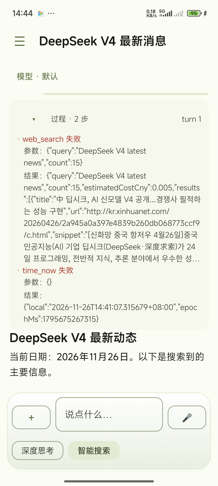
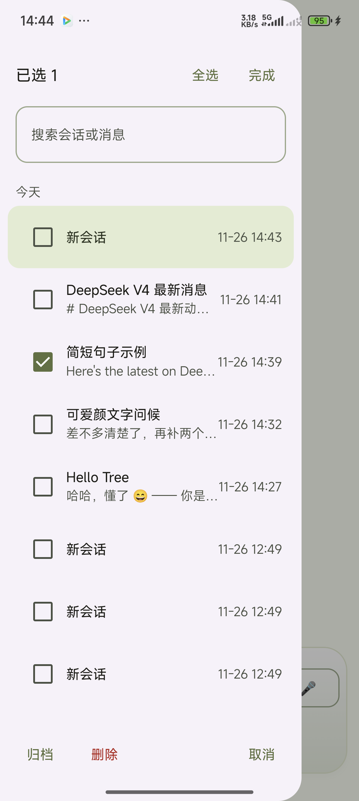

# UI/Bug 修复批次 2：流式消失、工具可见性、思考链、批量抽屉（2026-11-26）

## 1. 真机反馈修复

| 问题 | 根因 | 修复 | 状态 |
|---|---|---|---|
| 流式吐字后眨眼消失，要切分支再切回 | ChatMessages 内部 activeLeaf 只在首次 remember，bridge 发送后 activeLeaf 变了但 UI 没同步，渲染路径只剩旧叶子（不含新回答） | `LaunchedEffect(initialActiveLeaf)` 同步 prop；发送/重生成后 reload 带回新 activeLeaf | ✅ 真机验证（回答保留） |
| 启动闪"开始聊天"页 | screen 初始为 null，EmptyState 先渲染，ensureDraft 异步才切走 | 删除 EmptyState；screen 为 null 时渲染空白，ensureDraft 后进入新会话 | ✅（启动无闪页） |
| 看不到工具调用/结果 | 1) tool/call 的 args 是 JSON 对象，被当 primitive 读 → reload 崩溃回主屏；2) 过程折叠默认收起/条件过严 | args 用 toString；工具折叠移入 assistant item 并默认展开；显示参数+结果全文（截断）；MAX_TOOL_STEPS 4 → 64 | ✅ 真机验证 web_search/time_now 参数与结果可见 |
| 开启深度思考看不到思维链 | 之前 reasoning 只在有工具步骤时显示；流式 reasoning 未展示 | 渲染条件改为"有 reasoning 就显示"；流式中实时显示 `思考过程`；完成后折叠内显示思考全文 | ✅ 真机验证 DeepSeek 思考链可见 |
| 工具 4 步被强停 | MAX_TOOL_STEPS=4 | 改为 64；不再低上限 | ✅ 代码 |

## 2. 抽屉批量操作（新）
- 抽屉头部新增「选择」：进入多选模式，行前出现 Checkbox，支持全选/完成/取消。
- 底部批量栏：归档 / 删除（软删），操作后关闭抽屉并给 Snackbar「已归档/删除 N 个 · 撤销」，撤销批量恢复。
- 批量删除/归档不再逐个点；当前会话被批删时自动进入新会话草稿。

## 3. 真机验证

- 正常回答流式结束后内容保留 ✅
- 多步工具：web_search + time_now 真实调用，过程折叠展开显示参数/结果 ✅
- DeepSeek 思考链：折叠显示 "思考：The user says..." ✅
- 批量抽屉：已选 1、全选、归档/删除按钮 ✅（未实际执行删除用户数据）
- 截图：   

## 4. 仍待办
1. 单条删除/归档目前仍会关抽屉（批量已不苦）；是否改成"不关抽屉 + 行内撤销"待定。
2. 工具结果展示还是纯文本 JSON；计划抄 DeepSeek chat demo 的搜索来源卡片/引用。
3. DeepSeek 思考强度是否真正映射到 API（当前模型无 reasoning 元数据；需配带档位的模型验证）。
4. 分支指示器/旧分支提示、work 分支会话模型。
5. M3 手势/预测式返回、M5 设计系统。
