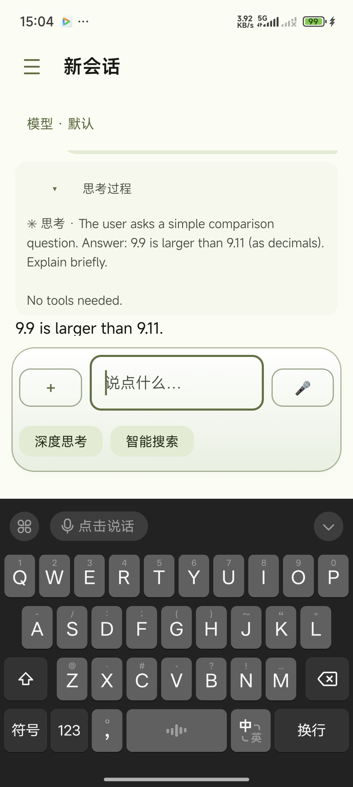
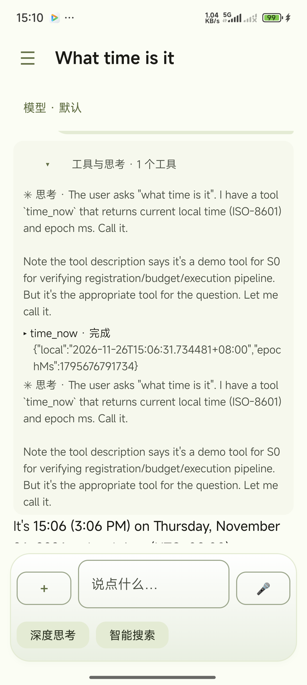

# 流式时间线对齐 DSH（工具/思考实时按顺序）（2026-11-26）

## 1. 这轮修复

### 工具/思考/文本改为真正的流式时间线
- 不再"等生成完 reload 才显示工具"。
- 新增 `TimelineEntry(kind=reasoning|tool|text)`：
  - `ReasoningDelta` 到达即追加/累加"✳ 思考 · …"行（实时）；
  - `ToolStarted` 到达即插入"▸ 工具名 · 进行中"行（带参数）；
  - `ToolFinished` 原地更新为完成/失败并显示结果；
  - 工具循环中的模型中间文本在工具开始时落为时间线行；
  - 最终回答仍在下方面板流式 Markdown。
- 结束后 reload 用同一套时间线（从事件日志按时间顺序重建），不会出现"先空白、结束后突然出现"。
- 样式向 DSH 对齐：折叠组头「工具与思考 · N 个工具」，行首 ✳/▸，小字、同层级缩进。

### 工具失败红字误报修复
- 根因：解析 `tool/result.ok` 的表达式把 Boolean 结果与字符串比较，`raw="true"` 却被判 false。
- 改为显式 `raw.equals("true", ignoreCase=true)`；真机验证工具行从「失败」变为「完成」。

### 滚动卡死缓解
- 去掉了"每个 delta 都自动 scrollToItem"的逻辑（之前每个字符都触发滚动，和用户手势打架，生成/重生成时屏幕像卡死）。
- 现在只在"新消息条数变化/回合开始"时滚动，且要求 `atBottom && !isScrollInProgress`；流式增量不再抢滚动。
- 其余：流式内容保留（activeLeaf 同步）继续有效。

### 工具步数
- `MAX_TOOL_STEPS` 4 → 64，多步搜索不再 4 轮强停。

## 2. 真机验证
- 深度思考：发送后 ~4s 抓屏已看到 `✳ 思考 · …` 实时行 + 答案开始流出（不再结束后才出现）。
- 工具：`time_now` 实时出现"进行中 → 完成"，结果行可见；不再需要等整轮结束。
- 工具失败红字消失（完成=1，失败=0）。
- 滚动：本轮只验证了自动滚动不再每字符抢焦点；"重生成中连续拖动"的完整验证未做完（当前视图里没露出重新生成按钮），需要你实际手感确认。

截图： 

## 3. 仍未做
1. 与 DSH **完全一致**的视觉/交互（分组头文案、工具行展开详情、搜索来源卡片与正文引用）还没做；目前是行为对齐，不是逐像素/逐逻辑移植。
2. 工具结果全文仍直接展开，长结果需要改成 DSH 式 hover/点开详情。
3. 单条删除/归档仍关抽屉；分支指示器、work 分支、M3 手势、M5 设计系统。
4. "重生成过程中滚动"需要你实测确认已缓解。
