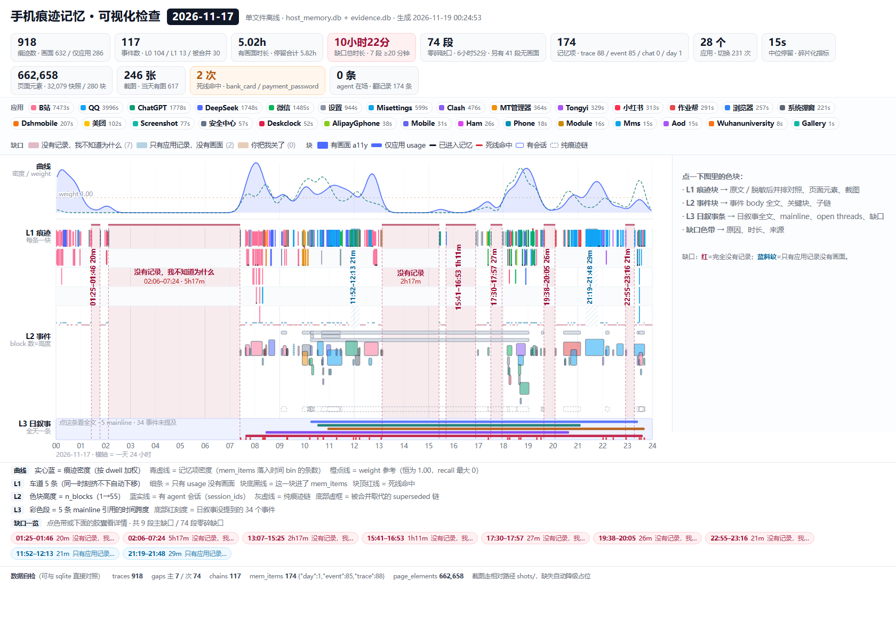

# 手机痕迹记忆 · 可视化检查（单文件离线）

把一天的手机痕迹画成三个能一眼看懂的东西：**注意力轨迹（色块）**、**断了的地方（空白带）**、
**记忆的三层金字塔（L1 块 / L2 事件 / L3 日叙事）**。

给作者做**视觉检查**用——确认「记忆模型长得对不对」，不是产品 UI。

- 产物：`index.html`（1.6 MB，CSS/JS/数据全内联，**双击就能开，不联网、不用服务器、不用 npm**）
- 默认日期：`2026-11-17`
- 图表：**手写 SVG**，没有 d3/echarts/CDN，没有任何外部字体或图片依赖



---

## 1. 怎么重新生成

```bat
cd <workspace>\viz

:: 默认：2026-11-17，顺带把关键块截图拉下来（只拉没缓存的）
python build_viz.py

:: 换一天
python build_viz.py --date 2026-11-18

:: 截图策略
python build_viz.py --shots all      :: 当天全部 617 张
python build_viz.py --shots none     :: 一张不拉，全部走占位
python build_viz.py --no-pull        :: 只用 viz/shots/ 里已有的缓存，不碰设备

:: 改缺口阈值（默认 20 分钟，和日叙事的 gaps 口径一致）
python build_viz.py --gap-major-min 30

:: 验收自检（对照 DB 复核每个数字 + 无头浏览器实测点击）
python selfcheck.py
```

Python 解释器（本机已装 pandas/numpy/Pillow）：

```
C:\Users\<user>\.dsh\dsh-runtimes\dsh-primary-runtime\dependencies\python\python.exe
```

`build_viz.py` 会自己调 adb 拉截图，adapter 路径写在文件顶部 `ADB` 常量里，换机器改那一行即可。

---

## 2. 数据从哪来

| 来源 | 内容 | 说明 |
|---|---|---|
| `raw/v2/device/host_memory.db` | `mem_items` / `chains` / `day_narratives` / `trace_gaps` | 记忆层 |
| `raw/v2/device/evidence.db` | `traces` / `page_elements` / `trace_gaps` | 证据层，160 MB，需要自己 pull |
| 设备 `files/trace/shots/*.jpg` | 截图 | 按需 pull，缩放成 520px 宽 JPEG(q72) 存到 `viz/shots/` |

**只读保证**：两个 sqlite 都用 `file:...?mode=ro` 打开（不是普通 connect），
对 `raw/` 只读、不写、不建索引；全程不碰 `app/v2/`。截图是从设备读到本地新文件，原图不动。

### 拉 evidence.db 的坑

`adb exec-out ... > file` 在 **PowerShell 下会把二进制写坏**（UTF-16 转码，文件变成 0 字节或错位）。
用附带的小工具（内部走 Python 直接写二进制）：

```bat
python pull_device_db.py              :: 拉 evidence.db（约 160MB）
python pull_device_db.py --what memory
```

---

## 3. 每个视图在展示什么

### 3.1 顶部 KPI（12 个格子）

一行看完一天的量级，每个数字都能和 sqlite 直接对上（`selfcheck.py` 会逐项核对）：
痕迹数、事件数、有画面时长、缺口总时长、零碎缺口、记忆项分布、应用数、中位停留、
页面元素、截图、死线命中、agent 在场。

### 3.2 曲线区（最上面那条）

「函数与色块」里的**函数**。

- **实心蓝面积** = 注意力密度：把当天 trace 按 `dwell_ms` 加权落到 5 分钟 bin 里再做高斯平滑。
  高就是"这段时间一直在动手机"，平/零就是"没在看"。
- **青色虚线** = 记忆项密度：`mem_items`（trace + event）按 `t0` 落 bin 的条数。
  和蓝色不重合的地方，就是「有痕迹但没被记住」。
- **橙色点线** = `weight` 参考线。这一天它是一条直线（见 §5.4）。

### 3.3 L1 痕迹车道（主图）

- 每条 `traces` 记录 = 一个小色块，**颜色 = 应用**（图例在页面最上方，28 个应用固定配色）
- **横坐标 = 记录开始时刻，宽度 = 这一段占用的时间**（最小 1.7px，短到眨眼也看得见）
- **纵向 = 车道**：时刻重叠的记录自动往下排（像 git graph）。这一天最多同时 5 条
  （`usage` 的长记录 + 里面套着的 `a11y` 块），所以有 5 条车道
- **细一点的条** = 只有 `usage` 记录、没有画面（`source=usage`）
- **块底黑线** = 这一块进了 `mem_items`（918 块里只有 88 块，9.6%）
- **块顶红线** = 触发过死线（`guard_hit`）
- 悬停显示：时间、应用、页面标题、停留时长、是否关键块、所属事件

### 3.4 缺口色带（必须一眼看见的那个）

`trace_gaps` 表**是空的**（两个库里都是 0 行），所以缺口是**按覆盖度反推**的：
把当天所有 trace 的区间并起来，剩下的时段就是断档；≥2 分钟算缺口，≥20 分钟算主缺口。
分类看「画面（a11y）有没有」：

| 色带 | reason | 文案 | 这一天 |
|---|---|---|---|
| 红底 + 竖虚线，**贯穿 L1→L3** | `no_record` | **没有记录，我不知道为什么** | 7 段，共 10 小时 22 分 |
| 蓝斜纹，只在 L1 | `app_only` | **只有应用记录，没有画面** | 2 段（11:52–12:13、21:19–21:48） |
| 棕斜纹 | `recording_off` | **你把我关了** | 0 段（表里没有，通路保留） |

色带里写了时间范围和时长：宽带（≥190px）横排整句；中等宽度（62–190px）横排「短文案 + 时长」
（中文竖排会糊，所以竖排只留给纯 ASCII）；很窄的（<62px）竖排「时间 + 时长」。
页面底部还有一排**缺口胶囊**，点任意一个直接看详情（reason / 时长 / 落在里面的链）。

### 3.5 L2 事件层

`chains` 的粗色块：

- **高度 = `n_blocks`**（1→55，用 log 压过，不然 55 块的会把别的压扁）
- **颜色 = 该事件里块数最多的应用**（和图例同一套颜色）
- **蓝实线** = 有 agent 会话参与（`session_ids` 非空，110/123 条）
- **灰虚线** = 纯痕迹链（13 条）
- 上方灰条 = `level=1` 的**父链**（多段合并出来的聚合体），最多 3 行
- 底部虚线框 = `status=superseded` 的**旧链**（30 条，被合并取代，留作对照）
- 点任意块 → 右侧展开 body 全文、关键块、子链

### 3.6 L3 日叙事条

全天一条横杠。里面：

- 5 条**彩色段** = 日叙事 5 条 `mainline` 引用的那些事件，按事件的 `t0..t1` 取并集画出来
  → 一眼能看出「mainline 说的时间范围」和「L2 实际链条」哪里对不上
- **底部红色小刻度** = `unmentioned_event_ids`，日叙事完全没提到的 34 个事件
- 点这条 → 展开日叙事全文 + mainlines + open threads + gaps + 未提及事件列表

### 3.7 右侧详情（点开一个块看"里面有什么"）

**点 L1 块**：

- `page_title` / `activity` / `page_id`
- **原文 `text` 与 `masked_text` 并排**，做了字符级 diff：删的标红、增的标绿
  （先剪掉公共前后缀，只对中间不同的部分跑 LCS，所以再长的文本也是瞬间出来）
- 徽章：关键块 / 已进入记忆（带 weight、recall）/ **死线命中** / 脱敏改动情况
- **`page_elements` 列表**：这一块时刻附近（±8s 内最近的快照）的元素，`text + role + x/y`，按 y 排序
- **截图**（本地有就显示，没有就显示斜纹占位，绝不出现破图）

**点 L2 块**：body 全文、关键块（可点跳转）、子链、父链覆盖了哪些子链、状态徽章。
**点 L3**：日叙事全文、mainlines、open threads、gaps、未提及事件。
**点缺口色带**：原因、时长、来源、落在这一段里的事件。

---

## 4. 验收

`python selfcheck.py` 全绿，输出摘要：

```
1) 产物文件
  index.html 存在 · 1.59 MB (< 5MB) · shots/ 里 246 张

2) 内联数据 vs 数据库（全部相等）
  traces 918 / a11y 632 / chains 117 (L0 104, L1 13, superseded 30)
  mem_items 174 / page_elements 662,658 / 死线 2 / 应用 28 / 当天有图 617
  主缺口条数 = 日叙事 gaps 条数 = 7
  覆盖时长 5.020h = DB 并集 5.020h；零碎缺口 74 段 = DB 重算 74 段

3) 截图引用
  246 条路径全部存在且非空；918 块里 672 块没有本地图 → 页面走占位

4) 无头浏览器渲染（Edge headless）
  无 JS 错误 · SVG 1312 个 rect · L1 块 918 · L2 块 128 · 缺口胶囊 9

5) 三种详情视图（真的调点击处理函数）
  点 L1 块 ✓(原文/元素/截图/page_id) · 点 L2 ✓(body/关键块) · 点 L3 ✓(全文/open threads/gaps)
```

手工核对清单（都已确认）：

1. `python build_viz.py` 跑通，`index.html` 1.59 MB < 5 MB ✓
2. 打开就能看到 11-17 的轨迹、按应用分色、缺口色带（红色 7 段 + 蓝色 2 段）✓
3. 点 L2 出 body，点 L1 出 text/masked 并排 + 元素列表 + 截图 ✓
4. 页面统计数字与库里一致（见上）✓
5. 所有引用的图片都存在；缺失的走斜纹占位 + `onerror` 兜底 ✓

---

## 5. 数据里值得注意的形状

> 这些是画图时看出来的，不是猜的；每条都能在页面上找到对应位置。

### 5.1 `trace_gaps` 是空的，但日叙事自己列了 7 条缺口

两个库的 `trace_gaps` 都是 **0 行**。而 `day_narratives.gaps` 里有 7 条中文缺口描述。
按「≥20 分钟无记录」反推，**刚好得到同样 7 段，且起止时间完全一致**
（01:25–01:46 / 02:06–07:24 / 13:07–15:25 / 15:41–16:53 / 17:30–17:57 / 19:38–20:05 / 22:55–23:16）。

→ 说明缺口判定逻辑没坏，**只是没落库**。可视化这一层现在是「重算」而不是「读表」，
   图上每一段都标了 `reason` 与来源（`按覆盖度反推`）。

### 5.2 注意力极度碎片化

- 918 块，覆盖 5.02 小时，停留合计 5.82 小时（并发 ≤5 条）
- **中位停留 15 秒**；`<10s` 占 41%，`<60s` 占 92%
- 应用切换 **231 次**，按活跃时长算约 **46 次/小时**
- 最长的一段是 7.2 分钟（12:35 小米设置）

→ 形状是「一根根竖线 + 偶尔的宽块」，不是连续的河流。曲线区那些尖峰就是切换最密的时段。

### 5.3 一半的白天是空的，而且空得很整齐

24 小时里只有 5.02 小时有痕迹。最大的洞是 **02:06–07:24（5 小时 17 分，睡觉）**，
其次是 13:07–15:25（2h17m）和 15:41–16:53（1h11m）。
13:07–15:25 那个洞里 `L2` 还有一条父链跨着它——**父链的 t0/t1 是首末块，中间可以是完全空的**。
这是画图才看得出来的模型性质：链的时间跨度**不代表**这段时间都有记录。

### 5.4 `weight` 和 `recall_count` 这一层根本没被数据驱动

- 177 条 `mem_items` 里，`weight` 全是 **1.0**（只有那条 `chat` 是 1.5）
- `recall_count` **全是 0**，`superseded` 全是 0

→ 所以曲线区那条 `weight` 参考线是一条**直线**。显著性/衰减这套设计目前只有字段、没有运动。
   这是最该被看到的一张"平线"。

### 5.5 按作者自己的判据，「agent 在场」是 0 条

`evidence` 字段里，174 条全是 `[{"type":"trace"}]`，**没有一条 `chat` / `manual`**。
按「含 chat/manual 才算在场」的规则，这一天 **在场 0 条 / 翻记录 174 条**。
（11-18 那天有 1 条 `chat`，KPI 会变成「在场 1 条」，说明这条判据是通的。）

但 `chains.session_ids` 有 **110/123 条非空**。也就是说：链的正文是**会话里写出来的**，
可它引用的证据仍然只是 trace。**"事后整理" 和 "当场在场" 是两件事**，现有字段把这两件事混在了一个维度上。
图里我把它们分成两个视觉通道：蓝实线 = 有会话，灰虚线 = 纯痕迹链；在场与否另算。

### 5.6 三层金字塔的体积落差很大

| 层 | 数量 | 占下一层 |
|---|---|---|
| L1 痕迹块 | 918 | — |
| 进 `mem_items` 的块 | 88 | 9.6% |
| L2 事件 | 117（含 30 条被合并） | 837 块被 117 条链收走，平均 7.2 块/链 |
| L3 日叙事 | 1 条，5 条 mainline | mainline 只点名 83 个事件，**34 个事件没被提到** |

日叙事说「今天有 5 条主线」，但它引用的 49 个事件只覆盖了 L2 的一部分；
`unmentioned_event_ids` 里 34 个 ID 全部真实存在。L3 条底部那排红刻度就是它们。

### 5.7 脱敏几乎没动

592 个有文本的块里：**583 块 `masked_text` 与原文逐字相同**，5 块被改（微信里
`31232520…` → `3***@qq.` 这类），4 块 masked 为空。
`guard_hit` 只出现 2 次，都在 11-17：09:58 MT管理器（`bank_card`）、19:09 微信（`payment_password`）。

→ 图上 583 个块点开都是「两串完全相同」。掩码链路是"打了标记但基本没命中"，
   这一层的收益此刻接近 0，值得单独查。

### 5.8 页面元素只覆盖晚上

`page_elements` 662,658 行，但**只覆盖 18:09–23:41**（白天 0 行）。
918 块里有 280 块能找到 ±8s 内的元素快照。白天点开任何一块，元素区都会诚实地说"该时刻附近没有快照"。

---

## 6. 已知边界 / 有意为之的取舍

- **宽度用 `t1-t0` 而不是 `dwell_ms`**：这一天两者基本相等（t1-t0 是记录占用区间，dwell 是停留），
  用区间宽度才能让时间轴连续、不重叠。`dwell` 在悬停和详情里都有。
- **缺口阈值 20 分钟**是为对齐日叙事口径，可用 `--gap-major-min` 改；2 分钟以下的小缝不入图。
- **车道最多 5 条**（这一天并发上限就是 5），更多的话会压扁。
- **L2 高度用 log 压缩**：55 块的父链不压会把其余 116 条压成一条线。
- **截图默认只拉关键块**（246 张，约 10MB）。`--shots all` 是 617 张；
  没拉的块显示占位，不显示破图。
- **`--date 2026-11-18`** 跑得通：那天没有 `day_narratives`，L3 会显示
  「这一天没有日叙事（day_narratives 无记录）」；`agent 在场 1 条`（那条 `chat` 在 18 号）。
- 图表按 1600–1900px 宽设计；窗口 <1180px 时详情面板会掉到图下面。

---

## 7. 文件清单

```
viz/
├─ build_viz.py        生成器：读两个库 + 拉截图 → 写 index.html
├─ _template.html      HTML/CSS/JS 模板（build_viz.py 把 JSON 填进 /*__PAYLOAD__*/）
├─ index.html          单文件产物，双击打开
├─ shots/              被引用的截图（相对路径，246 张）
├─ selfcheck.py        验收自检（数字对账 + 无头浏览器点击测试）
├─ pull_device_db.py   二进制安全地从手机拉库
├─ preview.png         页面整体预览（本文顶部那张）
└─ README.md           本文件
```

`selfcheck.py` 会临时写 `_sc_page.html` 和 `_selfcheck_*.png`（详情视图截图），跑完可以删。
